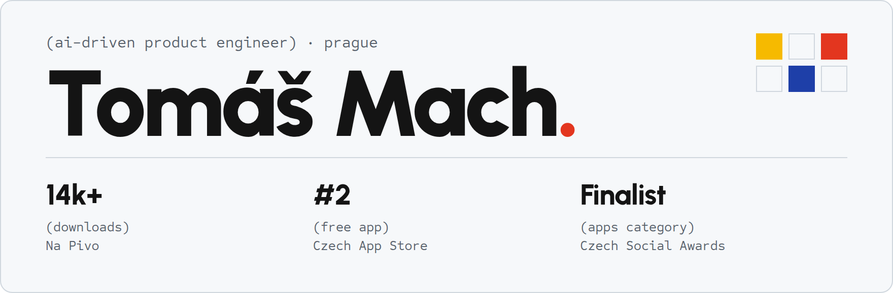
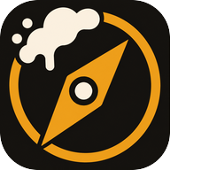

<picture>
  <source media="(prefers-color-scheme: dark)" srcset="assets/banner-dark.png">
  
</picture>

I build whole products: architecture, backend, frontend, AI agents, tests and deployment. Agents write a lot of my code, I decide what to build and check that it works.

 

<b><a href="https://upratehq.com">Uprate</a></b> · work at <a href="https://cleevio.com">Cleevio Labs</a> AI platform for running mobile apps on the App Store and Google Play. I'm its only engineer: backend, AI agents, frontend, tests and releases.

 

<b><a href="https://na-pivo.cz">Na Pivo</a></b> · my app · <a href="https://github.com/tomasmach/na-pivo">code</a> Beer diary for Czech and Slovak beer drinkers. 14k+ downloads, #2 free app in the Czech App Store and a finalist of Czech Social Awards 2026 in the Apps category. Built alone with Expo and Django.

 

<b><a href="https://nuzky.app">Nuzky</a></b> · my app · <a href="https://github.com/nuzkyapp/nuzky">code</a> Free, open-source video editor in the spirit of CapCut. Rust engine, local Whisper captions, AI agents editing the timeline over MCP. Early alpha.

 

<b>Before AI</b>

 
Nearly three years as a software developer at <a href="https://www.prusa3d.com">Prusa Research</a>: manufacturing automation, calibration over MQTT and Modbus, internal tools. Before that, drone engineer at DronPro.  
Fun fact: I lost over 70 kg and once ran a half-marathon without any training.

 

`(email)` [tomades1@gmail.com](mailto:tomades1@gmail.com) &nbsp; `(web)` [tmach.dev](https://www.tmach.dev/) &nbsp; `(status)` open to selected remote contract work and AI projects
